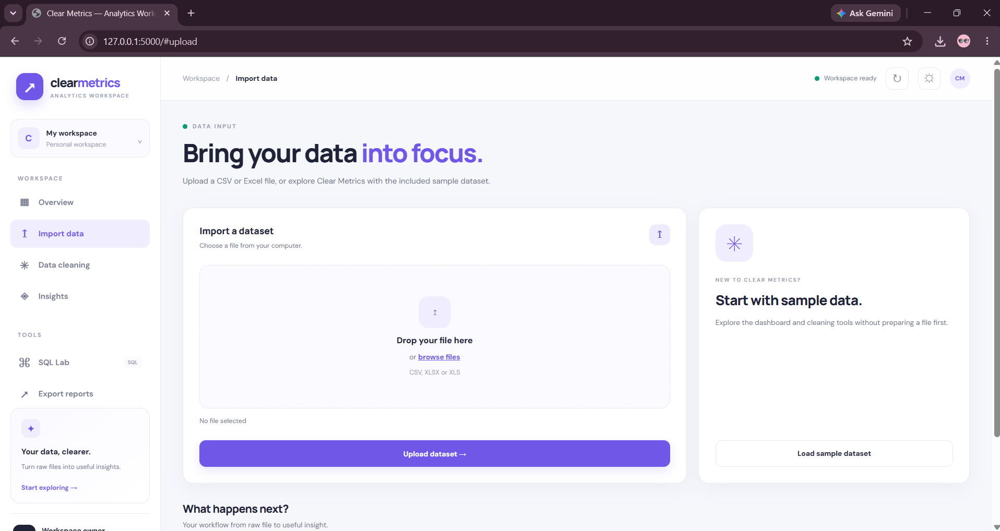
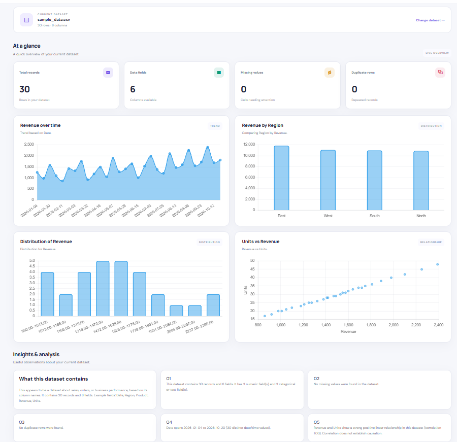
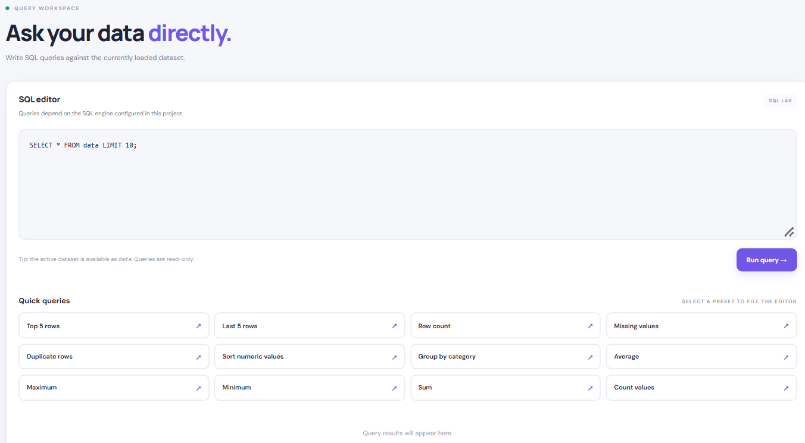

# Clear Metrics

Clear Metrics is a web application for exploring datasets, checking data quality, cleaning data, and running SQL queries through a simple interface.

## Features

- Upload CSV datasets and explore their contents.
- View dataset summaries and interactive charts.
- Check missing values, duplicate records, and data quality.
- Clean datasets using different strategies.
- Run SQL queries on uploaded data.
- View insights and compare data before and after cleaning.
- Export processed data and reports.

## Screenshots

### Dashboard


### Insights


### SQL Lab


## Built With

- Python
- Flask
- HTML and CSS
- JavaScript
- Chart.js
- Pandas
- SQL

## Getting Started

### 1. Clone the repository

```bash
git clone https://github.com/YOUR-USERNAME/ClearMetrics.git
cd ClearMetrics
```

Replace `YOUR-USERNAME` with your GitHub username.

### 2. Create a virtual environment

```bash
py -3.11 -m venv .venv
```

### 3. Activate the environment

On Windows PowerShell:

```powershell
.\.venv\Scripts\Activate.ps1
```

### 4. Install dependencies

```bash
python -m pip install -r requirements.txt
```

### 5. Run the application

```bash
python app.py
```

Open the following address in your browser:

`http://127.0.0.1:5000`

## Sample Dataset

The repository includes `sample_data.csv`, which you can use to explore the application's features.

## License

See the [LICENSE](LICENSE) file for license details.